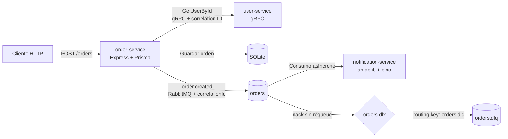

# Enterprise Event-Driven Microservices Monorepo

Monorepo de referencia para una arquitectura distribuida de órdenes basada en TypeScript, gRPC y mensajería con RabbitMQ. Reúne patrones habituales en sistemas backend: validación síncrona entre servicios, persistencia con Prisma, publicación asíncrona de eventos, circuit breaker, correlación de solicitudes y Dead Letter Queue (DLQ).

El diseño evita acoplar la aplicación a un proveedor cloud específico: usa protocolos y componentes que pueden ejecutarse localmente o en plataformas compatibles. La configuración incluida utiliza `RABBITMQ_URL` y puede apuntar a CloudAMQP. **Este repositorio es una base demostrativa y no debe considerarse lista para producción sin las mejoras operativas descritas en [Limitaciones y siguientes pasos](#-limitaciones-y-siguientes-pasos).**

## 📚 Índice

- [Arquitectura](#-arquitectura)
- [Patrones y capacidades](#-patrones-y-capacidades)
- [Stack tecnológico](#-stack-tecnológico)
- [Estructura del repositorio](#-estructura-del-repositorio)
- [Requisitos previos](#-requisitos-previos)
- [Configuración local](#-configuración-local)
- [Ejecución en desarrollo](#-ejecución-en-desarrollo)
- [Pruebas y compilación](#-pruebas-y-compilación)
- [Prueba del flujo HTTP](#-prueba-del-flujo-http)
- [Dead Letter Queue](#-dead-letter-queue)
- [Ejecución con Docker Compose](#-ejecución-con-docker-compose)
- [Limitaciones y siguientes pasos](#-limitaciones-y-siguientes-pasos)

## 🏛️ Arquitectura



### Servicios

| Servicio | Responsabilidad |
| --- | --- |
| **`user-service`** | Servidor gRPC en el puerto `50051`. Implementa `UserService.GetUserById` según [`proto/user.proto`](./proto/user.proto). La implementación actual valida contra un usuario mock: `id: "1"`, Ada Lovelace. |
| **`order-service`** | API REST con Express. `POST /orders` valida la solicitud, consulta al usuario por gRPC, persiste la orden con Prisma en SQLite y publica el evento `order.created` en RabbitMQ. |
| **`notification-service`** | Consumidor asíncrono de la cola durable `orders`. Registra los eventos con Pino; confirma los mensajes procesados y envía mensajes no procesables a la DLQ. |

El endpoint de órdenes espera un JSON con `userId`, `productId` y `quantity`. La cantidad debe ser un entero positivo.

## 🧩 Patrones y capacidades

- **Comunicación híbrida:** gRPC síncrono para validar usuarios y RabbitMQ asíncrono para publicar eventos desacoplados.
- **Circuit breaker:** `opossum` envuelve la llamada gRPC desde `order-service`. El circuito usa un timeout de 3000 ms y un umbral de errores del 50%; su fallback devuelve un error de indisponibilidad cuando está abierto.
- **Resiliencia con DLQ:** la cola `orders` declara `x-dead-letter-exchange: orders.dlx` y `x-dead-letter-routing-key: orders.dlq`. El consumidor procesa el JSON en un bloque `try/catch`; ante un error, ejecuta `nack(msg, false, false)` para no reencolar el mensaje en un bucle.
- **Trazabilidad distribuida:** `order-service` acepta o genera un `correlationId`, lo devuelve en el header HTTP `x-correlation-id`, lo envía como metadata gRPC y lo publica en los headers del mensaje RabbitMQ. Los logs de `user-service` y `notification-service` incluyen ese identificador.
- **Persistencia:** Prisma ORM v5 y SQLite. El modelo `Order` genera el ID y la fecha de creación.
- **Logging estructurado:** Pino en `user-service` y `notification-service`. `order-service` usa actualmente `console` para registrar errores.
- **Monorepo:** npm workspaces, TypeScript estricto, ESM y extensiones `.js` en imports relativos.
- **Contenedores:** Dockerfiles multi-stage basados en `node:20-alpine` y orquestación de los tres servicios con Docker Compose.
- **Pruebas:** Jest está configurado en `order-service`. La prueba existente es una comprobación estructural básica; todavía no cubre integraciones reales con gRPC, RabbitMQ o SQLite.

## 🛠️ Stack tecnológico

| Tecnología | Uso |
| --- | --- |
| Node.js 20 | Runtime y base de las imágenes Docker |
| TypeScript | Implementación con `strict` y módulos ESM |
| Express 5 | API HTTP de `order-service` |
| `@grpc/grpc-js` | Servidor y cliente gRPC |
| `@grpc/proto-loader` | Carga del contrato Protocol Buffers |
| RabbitMQ / `amqplib` | Transporte de eventos, confirmaciones y DLQ |
| Prisma ORM 5 | Acceso a datos y generación de IDs |
| SQLite | Base de datos de órdenes para desarrollo |
| Opossum | Circuit breaker para la llamada gRPC |
| Pino | Logging JSON estructurado |
| Jest / ts-jest | Pruebas de `order-service` |
| Docker / Compose | Empaquetado y ejecución de los servicios |

## 🗂️ Estructura del repositorio

```text
.
├── docker-compose.yml
├── proto/
│   └── user.proto
├── user-service/
│   ├── Dockerfile
│   └── src/index.ts
├── order-service/
│   ├── Dockerfile
│   ├── prisma/schema.prisma
│   └── src/
│       ├── broker/index.ts
│       ├── controllers/index.ts
│       ├── grpc/index.ts
│       └── index.ts
└── notification-service/
    ├── Dockerfile
    └── src/
        ├── consumer/index.ts
        └── index.ts
```

## ✅ Requisitos previos

- Node.js 20 o superior y npm.
- Una instancia RabbitMQ accesible por AMQP. Para el flujo descrito se puede usar CloudAMQP u otro broker compatible.
- Docker Engine y Docker Compose v2, si se ejecuta en contenedores.

## ⚙️ Configuración local

Instala las dependencias desde la raíz del repositorio:

```bash
npm install
```

Crea `order-service/.env` y `notification-service/.env`. No subas credenciales al control de versiones.

`order-service/.env`:

```dotenv
PORT=3000
RABBITMQ_URL=amqps://<usuario>:<contraseña>@<host>/<vhost>
DATABASE_URL="file:./dev.db"
```

`notification-service/.env`:

```dotenv
RABBITMQ_URL=amqps://<usuario>:<contraseña>@<host>/<vhost>
```

Reemplaza la URL de ejemplo por la URL AMQP de tu instancia. `DATABASE_URL` es la URL de conexión de SQLite que Prisma lee para el esquema en `order-service/prisma/schema.prisma`.

Genera el cliente Prisma y crea o actualiza la base local:

```bash
cd order-service
npx prisma db push
cd ..
```

`db push` sincroniza el esquema sin crear archivos de migración. Para un flujo de despliegue con historial y revisiones de esquema, configura migraciones versionadas antes de usar el proyecto en producción.

## 🚀 Ejecución en desarrollo

Abre una terminal para cada servicio. Los scripts `dev` usan `tsx watch`.

```bash
npm run dev --workspace=user-service
```

```bash
npm run dev --workspace=order-service
```

```bash
npm run dev --workspace=notification-service
```

`user-service` escucha en `0.0.0.0:50051`; `order-service` usa `PORT` (por defecto, `3000`). El consumidor y el productor se conectan al broker indicado por `RABBITMQ_URL`.

## 🧪 Pruebas y compilación

Ejecuta la prueba Jest disponible:

```bash
npm test --workspace=order-service
```

Compila los tres workspaces con TypeScript:

```bash
npm run build
```

Los scripts de inicio de producción ejecutan `dist/index.js` dentro de cada workspace:

```bash
npm start --workspace=user-service
npm start --workspace=order-service
npm start --workspace=notification-service
```

Para `order-service`, prepara previamente `.env` y la base de datos. Para los tres servicios, asegúrate de que RabbitMQ esté accesible antes de iniciar los procesos.

## 🌐 Prueba del flujo HTTP

Crea una orden para el usuario mock `1`:

```bash
curl -i -X POST http://localhost:3000/orders \
  -H "Content-Type: application/json" \
  -H "x-correlation-id: demo-order-001" \
  -d '{
    "userId": "1",
    "productId": "prod-123",
    "quantity": 2
  }'
```

La respuesta esperada es `201 Created`, incluye la orden persistida con su `id` generado y devuelve `x-correlation-id: demo-order-001`. El mismo identificador se propaga a los metadatos de gRPC, al evento RabbitMQ y a los logs que lo reciben.

Prueba un usuario inexistente:

```bash
curl -i -X POST http://localhost:3000/orders \
  -H "Content-Type: application/json" \
  -d '{
    "userId": "missing-user",
    "productId": "prod-123",
    "quantity": 1
  }'
```

`user-service` responde `NOT_FOUND` y la API devuelve `404 User not found`; no se persiste ni publica esa orden.

## ☠️ Dead Letter Queue

El consumidor rechaza sin reencolar un mensaje cuyo cuerpo no se puede interpretar como JSON. Para verificarlo en desarrollo:

1. Abre la consola de administración de tu broker RabbitMQ.
2. Publica en el exchange por defecto (`Default exchange`) con routing key `orders`.
3. Usa un cuerpo inválido, por ejemplo:

   ```text
   {json-invalido
   ```

4. El consumidor registrará el fallo y ejecutará `nack` con `requeue=false`.
5. Comprueba el mensaje en `orders.dlq` (a través del exchange `orders.dlx`).

La DLQ almacena mensajes fallidos, pero este repositorio no incluye un consumidor para reprocesarlos ni una política de retención/alertas para esa cola.

## 🐳 Ejecución con Docker Compose

Compose construye los tres servicios y carga las variables de RabbitMQ desde `order-service/.env` y `notification-service/.env`. El broker **no** se ejecuta en Compose: debes proporcionar un RabbitMQ externo mediante `RABBITMQ_URL`.

```bash
docker compose up --build
```

La API queda disponible en `http://localhost:3000` y gRPC se publica en el puerto `50051`. Para cambiar el puerto HTTP publicado, define `ORDER_SERVICE_PORT` en el entorno desde el que ejecutas Compose; por defecto es `3000`.

Para detener los servicios:

```bash
docker compose down
```

La base SQLite del contenedor vive en su sistema de archivos si no configuras un volumen. En consecuencia, los datos podrían perderse al recrear el contenedor. Configura almacenamiento persistente antes de usar Docker con datos que deban conservarse.

## ⚠️ Limitaciones y siguientes pasos

Este repositorio demuestra patrones de arquitectura, pero no afirma por sí solo tolerancia a fallos ni preparación de producción:

- `user-service` usa un usuario mock en memoria; no hay almacenamiento ni gestión real de usuarios.
- SQLite es apropiado para desarrollo o demostraciones, pero no resuelve por sí mismo alta disponibilidad, concurrencia distribuida ni backups de producción.
- La persistencia de la orden y la publicación RabbitMQ son operaciones separadas. Si el publish falla después de guardar la orden, la API puede responder `503` aunque el registro ya exista. Un **transactional outbox** y un publicador idempotente ayudarían a evitar esa inconsistencia.
- El circuito Opossum protege la llamada gRPC, pero no reemplaza health checks, políticas operativas, métricas ni alertas.
- La DLQ captura mensajes rechazados; falta el proceso de inspección/reproceso y la política de retención.
- Los tests existentes son básicos y no validan integraciones reales, concurrencia, reintentos, seguridad ni disponibilidad.
- No hay autenticación/autorización de API, TLS configurado para gRPC, health checks de contenedor, gestión de secretos ni volumen SQLite en Compose.
- El contrato actual de `order.created` es JSON publicado directamente en la cola `orders`; no incluye versionado de esquema ni un exchange dedicado para eventos de dominio.

Para un despliegue real, añade pruebas de integración, telemetría y health checks, protección de datos y secretos, persistencia adecuada al entorno, migraciones Prisma y una estrategia transaccional para la publicación de eventos.
